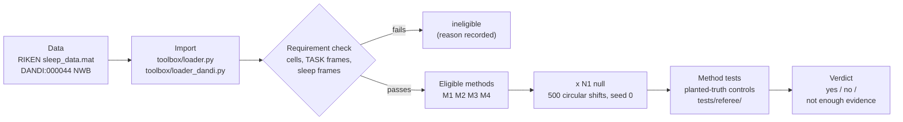
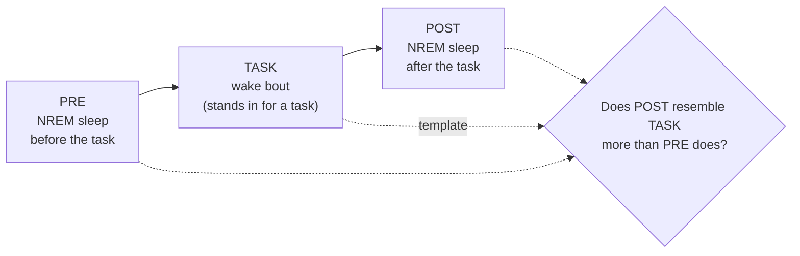
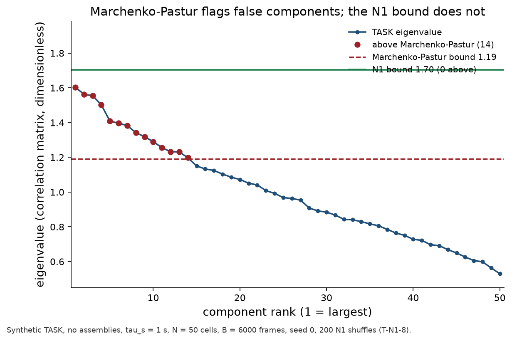
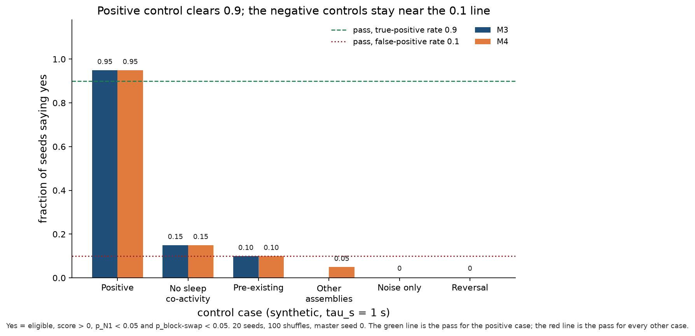
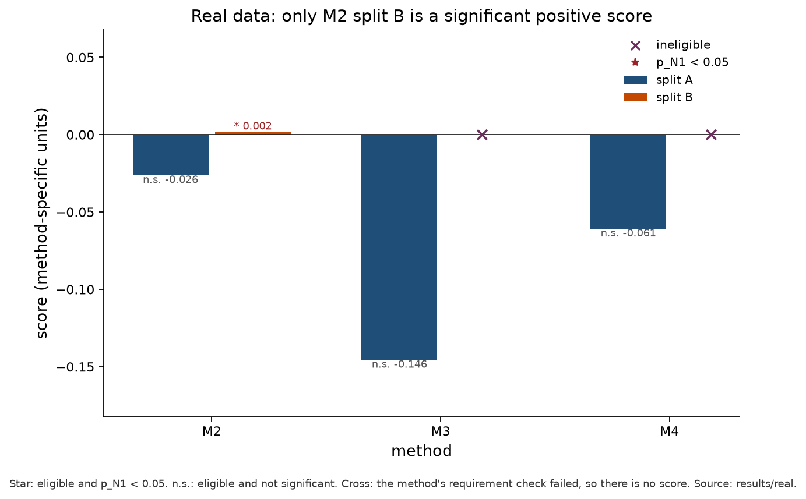
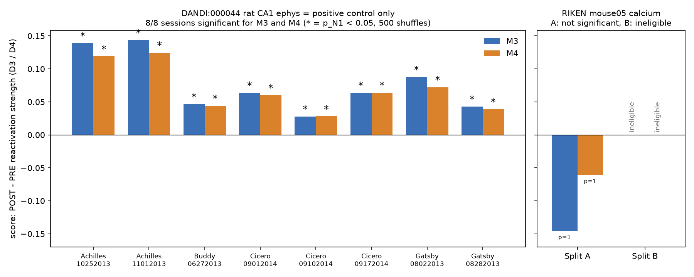

# Shift Happens: a reactivation toolbox that knows when not to trust itself

Claude Impact Lab hackathon project, 2026-11-07.
An open toolbox that asks whether neurons recorded with two-photon calcium imaging show sleep reactivation: sleep after a task (POST) resembling the task (TASK) more than sleep before it (PRE), NREM frames only.
It runs four standard methods (Tingley and Peyrache 2020: M1 cell-pair correlation, M2 explained variance vs. reverse, M3 PCA and M4 ICA reactivation strength), each against the same null (N1: every neuron's trace circularly shifted by its own random offset, 500 times, seed 0).
The question, number, unit and "yes" threshold per method are fixed in [PROBLEM.md](PROBLEM.md), and a method only counts if it passes planted-truth synthetic controls ([tests/referee/](tests/referee/)).
On the one public RIKEN calcium session the answer is **not enough evidence**, and no counted method says "yes".
On 8 rat electrophysiology sessions with known reactivation (DANDI:000044, used only as a positive control) M3 and M4 are significant in 8/8, so the toolbox can say "yes" on real data.
Submission text: [SUBMISSION.md](SUBMISSION.md); demo script: [DEMO.md](DEMO.md).

## Team

The name comes from the N1 circular-shift null, which is what made the analysis honest on calcium data.

| Member | GitHub | Role |
|---|---|---|
| Batu | [BatuCani](https://github.com/BatuCani) | Engineer A: loader, M1, M2, submission |
| youssef-110 | [youssef-110](https://github.com/youssef-110) | Engineer B: N1 null, M3 PCA, M4 ICA, DANDI positive control |
| ZixiTang | [ZixiTang](https://github.com/ZixiTang) | criterion and verdict rule |

There is no scientist on the team: the answer key was signed by the team lead ([PROBLEM.md](PROBLEM.md) "Signature").

## The problem in one picture

The pipeline: a method only runs when the data meets its requirements, every method is tested against the same N1 null, and a method only votes if it passed its own planted-truth tests.



The comparison each method makes, within one recording:



## Key findings



The spike-era bound fails on calcium: Marchenko-Pastur flags at least 5 false components in 50/50 synthetic noise runs, the N1 bound flags at least one in 2/50 ([journal/engineer-b.md](journal/engineer-b.md) T-N1-8).



M3 and M4 on planted-truth controls: the positive control says "yes" on 0.95 of seeds for both methods; no-sleep co-activity is 0.15, just above the 0.1 line ([results/figures/README.md](results/figures/README.md)).



RIKEN mouse05 Split A points the wrong way for every method: D1 = -0.069, D2 = -0.026, D3 = -0.146, D4 = -0.061, all p_N1 = 1.0 ([results/real/](results/real/)).



DANDI:000044 rat CA1 ephys is a positive control only: M3 and M4 have p_N1 = 0.002 in 8/8 sessions (D3 = +0.028 to +0.144), while RIKEN Split A is not significant and Split B is ineligible for M3 and M4 ([scripts/plot_overview.py](scripts/plot_overview.py), [results/real/dandi/summary.csv](results/real/dandi/summary.csv)).

## Results

RIKEN mouse05, one recording split into two pseudo-sessions ([results/real/](results/real/), `M*_split*.json`):

| Method | Split A score | Split A p_N1 | Split B score | Split B p_N1 |
|---|---|---|---|---|
| M1 cell-pair correlation (D1) | -0.069 | 1.0 | +0.006 | 0.19 |
| M2 EV vs. REV (D2) | -0.026 | 1.0 | +0.002 | 0.002 (p_blockswap 0.25; M2 fails its control) |
| M3 PCA (D3) | -0.146 | 1.0 | ineligible | 651 TASK frames < 1500 |
| M4 ICA (D4) | -0.061 | 1.0 | ineligible | 651 TASK frames < 1500 |

DANDI:000044 positive control, 8 sessions ([results/real/dandi/summary.csv](results/real/dandi/summary.csv)):

| Method | Sessions with score > 0 and p_N1 < 0.05 | Score range |
|---|---|---|
| M3 PCA (D3) | 8/8 | +0.028 to +0.144 |
| M4 ICA (D4) | 8/8 | +0.028 to +0.125 |

Methods that fail their own tests stay out of the vote: M2 gives 6/10 false "yes" with pre-existing assemblies, and M4 misses T-M4-1 (PCA 0.817 vs. < 0.8 required); the thresholds were not moved ([tests/test_m2.py](tests/test_m2.py), [journal/engineer-b.md](journal/engineer-b.md) Entry 2).

### Verdict

**Not enough evidence** on RIKEN mouse05: only M1 is counted in both splits, and the rule needs two.
The rule is in [toolbox/verdict.py](toolbox/verdict.py); it was applied by hand because it is not yet wired into `run.py`, and the full reasoning is in [SUBMISSION.md](SUBMISSION.md) "What the loop found".

## Honest limitations

- One RIKEN session, one animal (mouse05); Split A and Split B are halves of the same recording, not independent replicates ([results/real/M2_verdict.json](results/real/M2_verdict.json) "caveat").
- No behavioural task in the RIKEN data: a wake bout stands in for TASK.
- Split B has too few TASK frames for M3 and M4.
- The answer key was signed by the team lead without a scientist sign-off ([PROBLEM.md](PROBLEM.md) "Signature").
- DANDI:000044 is electrophysiology, not calcium: it shows the toolbox can say "yes" on real data, not that calcium reactivation exists.
- A firing-rate confound between PRE and POST is not yet ruled out; the test is predicted in [JOURNAL.md](JOURNAL.md) (PREDICT Loop 3) with no result yet.
- `toolbox/verdict.py` is not yet wired into `run.py`.

Every prediction is committed before its run and every failure stays in [JOURNAL.md](JOURNAL.md).

## Research loop

Diagram: [research/research-loop.png](research/research-loop.png).

1. Read: literature and dataset search, distilled into [research/](research/) ([research/source-of-truth.md](research/source-of-truth.md), [research/CALCIUM_METHODS.md](research/CALCIUM_METHODS.md), [research/datasets/calcium-vetting.md](research/datasets/calcium-vetting.md)).
2. Lock: [PROBLEM.md](PROBLEM.md), the question and the answer key (number, unit, threshold per method), fixed before any real-data result and signed by the team lead.
3. Referee: tests with fixed thresholds, written before the code ([tests/referee/](tests/referee/), [tests/](tests/)).
4. Loop per task in [TASKS.md](TASKS.md): READ -> PREDICT -> RUN (test first) -> JUDGE -> RECORD.
5. Record: [JOURNAL.md](JOURNAL.md), append-only, one entry per step, each labelled verified, contradicted or not enough evidence.
   A finding is a number with a result file only.

## How to run

Python 3.12 via `uv`; no API keys.
The data is not in this repository.

```bash
# data: RIKEN CBS, Zenodo 17667863, CC BY 4.0 (1.9 GB zip)
curl -L --fail --output mouse_data.zip \
  "https://zenodo.org/records/17667863/files/mouse_data.zip?download=1"
unzip mouse_data.zip mouse_data/sleep_data.mat

# tests (fast; add -m slow for the 50-seed counted method tests)
uv run --python 3.12 --group dev pytest -m "not slow"

# every RIKEN result file, seed 0, 500 N1 shuffles -> results/real/
uv run --python 3.12 python run.py --data mouse_data/sleep_data.mat --seed 0

# positive control: M3 and M4 on the 8 DANDI:000044 sessions (streamed) -> results/real/dandi/
OMP_NUM_THREADS=1 uv run --python 3.12 --with remfile python scripts/run_dandi.py --seed 0

# referee figures -> results/figures/
uv run --python 3.12 --with matplotlib python scripts/plot_referee.py

# overview figure -> results/figures/positive_control_vs_riken.png
uv run --python 3.12 --with matplotlib python scripts/plot_overview.py
```

## Repository map

```text
PROBLEM.md              question and answer key, signed by the team lead (see its Signature section)
TASKS.md                ordered loop task list with owners
JOURNAL.md              append-only notebook; journal/engineer-b.md holds Engineer B's full counts
SUBMISSION.md           submission text for the lab's issue template
DEMO.md                 3-minute demo script
run.py                  one command: RIKEN .mat -> results/real/*.json (method tests and verdict not yet wired in)
pyproject.toml, uv.lock numpy, scipy, scikit-learn, h5py; pytest for tests
toolbox/
  contract.py           shared data contract (Recording) and return type (MethodResult)
  loader.py             RIKEN loader -> Recording per split            (A)
  loader_dandi.py       DANDI:000044 streaming loader (positive control)
  m1_pair_corr.py       M1 cell-pair correlation                        (A)
  m2_ev_rev.py          M2 EV vs. REV                                   (A)
  nulls.py              N1 circular-shift null, p-values, seeded streams (B)
  assemblies.py         z-score, eigen, projectors, R(t), N1 eigen bound (B)
  m3_pca.py             M3 PCA reactivation strength                    (B)
  m4_ica.py             M4 ICA reactivation strength                    (B)
  synth.py              synthetic calcium-like data for method tests    (B)
  controls.py           positive / negative control runs                (B)
  verdict.py            verdict rule                                    (Zixi)
scripts/                run_dandi.py (positive control), plot_referee.py and plot_overview.py (figures), per-method runners
tests/                  test-first: one test file per module; tests/referee/ planted-truth cases
results/
  real/                 RIKEN results per method and split; real/dandi/ positive control
  loader/               frame counts per split
  figures/              figures and the command that draws them (results/figures/README.md)
research/               literature, datasets, source of truth
plans/                  engineer plans
```

The package follows the file layout of [plans/engineer-b.md](plans/engineer-b.md) section 3, as a flat `toolbox/` package: `src/reactivation/<module>.py` there is `toolbox/<module>.py` here, imported as `toolbox.<module>`.

## Citations

- Tingley, D. and Peyrache, A. (2020). On the methods for reactivation and replay analysis. Phil. Trans. R. Soc. B 375: 20190231, DOI [10.1098/rstb.2019.0231](https://doi.org/10.1098/rstb.2019.0231). Source of M1 to M4 ([research/source-of-truth.md](research/source-of-truth.md)).
- RIKEN CBS mouse sleep two-photon calcium data, Zenodo record [17667863](https://zenodo.org/records/17667863), CC BY 4.0.
- DANDI:000044, rat CA1 electrophysiology with PRE / TASK / POST sleep, [dandiarchive.org/dandiset/000044](https://dandiarchive.org/dandiset/000044), used only as a positive control.

## Licences

- **Code** is licensed under the [Apache License 2.0](LICENSE).
- **Written material** (problem description, journal, results summaries and other documentation) is licensed under [Creative Commons Attribution 4.0 International (CC BY 4.0)](LICENSE-CC-BY-4.0).

This follows the default of the [Claude Impact Lab rules](https://github.com/xemantic/claude-impact-lab-2026).
Third-party papers and datasets keep their own licences; see [research/papers/README.md](research/papers/README.md).
