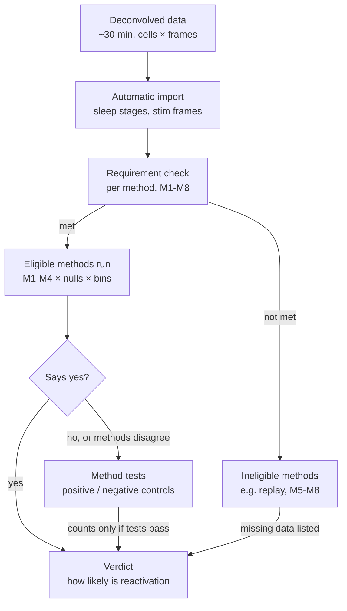

# Reactivation Toolbox - Team Brief

Transcribed from five screenshots of a claude.ai doc dated 7 Nov 2026, kept in reading order in [team-brief/](team-brief/): `brief-4.png`, `brief-5.png`, `brief-6.png`, `brief-7.webp`, `brief-8.webp`.

Transcription notes:
- The original uses em dashes in the title and in the plan headings; they are written here as a plain dash "-".
- Hyperlinks appear in the screenshots as link text only, so their targets are not visible and are not given here.
- Text that is cut off at a screenshot edge is marked as such; nothing has been filled in.
- The screenshots may not cover the whole doc: the gap between `brief-7.webp` and `brief-8.webp` and anything after the last reference visible in `brief-8.webp` are not captured.

7 Nov. 2026 · @Someone

We build a toolbox that imports deconvolved neuronal activity with its sleep stages automatically, runs only the reactivation methods the data can support, and states how likely it is that the data show reactivation.
Data: a public dataset (lab data is not available).

## 1. Background

**Reactivation.**
Neurons that are active together during a task tend to be active together again in the sleep that follows.
It is tested on the same neurons in three periods: sleep before the task (PRE), the task (TASK), and sleep after it (POST).
Reactivation means POST resembles TASK more than PRE does.

**Input.**
Deconvolved two-photon calcium imaging: a matrix of neurons × frames, plus a sleep-stage label (wake, NREM, REM) per frame.

**Why it is hard.**
The methods were built for sparse electrophysiology spikes; calcium data is slow, so neighbouring frames are correlated and tests built for spikes can be too lenient.
Tingley & Peyrache (2020) also show that methods often disagree on the same data.
So each method must pass checks before its answer counts.

## 2. How the toolbox works

Diagram title: **Only methods whose data requirements are met get a say in the verdict**

Methods whose requirements fail are not run; the report lists what data they would need.
Eligible methods run; a "no" or a disagreement sends them through method tests, and only methods that pass the tests count toward the verdict.

## 3. Today's plan

Thirty minutes of data search, then three tracks in parallel.

**0:00-0:30 - find data (both engineers)**

- [ ] Engineer A: search DANDI (keywords: sleep, NREM, reactivation, replay, two-photon sleep, miniscope sleep).
- [ ] Engineer B: search other repositories (CRCNS, G-Node, Zenodo, figshare, paper data statements).
- [ ] A dataset qualifies if it has deconvolved (or deconvolvable) calcium data, PRE / TASK / POST from the same cells, sleep stages, and a usable licence.
- [ ] At 0:30, nothing qualifies → use the RIKEN cortex dataset, with a wake bout between two sleep bouts standing in for TASK.

**0:30 onwards - three parallel tracks**

- [ ] Engineer A: loader for the chosen dataset, then M1 and M2.
- [ ] Engineer B: null model N1, then M3 and M4.
- [ ] Zixi: the final criterion for "reactivation yes / no": the method tests each method must pass, and the rule that turns method results into one verdict.

**Last 30 min - put it together**

- [ ] Run all working methods on all sessions; apply Zixi's criterion; one results table and a short demo following the diagram.

## 4. Inputs and methods

**What the loader imports automatically**

| Field | Required | Meaning |
|---|---|---|
| `sleep_stage` | Yes | Label per frame: wake, NREM, REM, unscored |
| `deconv` | Yes | Deconvolved activity, cells × frames (raw, never smoothed) |
| `session_type` | Yes | baseline, training, test or spontaneous |
| `stim_frames` | If a task exists | Onset, offset and identity of each stimulus |
| `fs`, `cell_id`, `mouse_id`, `session_id` | Yes | Frame rate and bookkeeping |

Missing a required field → stop with a clear message.
From these fields the loader derives PRE / TASK / POST per frame.

**Methods (all from Tingley & Peyrache 2020; PRE and POST use NREM frames only)**

| ID | Method | Owner | "Yes" means | Needs |
|---|---|---|---|---|
| M1 | Cell-pair correlation | Engineer A | TASK-POST similarity of pairwise correlations > TASK-PRE | PRE, TASK, POST, same cells |
| M2 | Explained variance vs. reverse (EV / REV) | Engineer A | EV > REV across sessions | As M1, several sessions |
| M3 | PCA reactivation strength | Engineer B | Mean strength in POST > PRE | At least one significant TASK compo [cut off at the screenshot edge] |
| M4 | ICA reactivation strength | Engineer B | As M3 | At least two significant components [may continue past the screenshot edge] |

[The top of `brief-8.webp` shows the bottom border of a table; the text between `brief-7.webp` and `brief-8.webp`, if any, is not captured.]

EV, with r(A,B) the correlation between two flattened pairwise-correlation matrices (REV swaps PRE and POST):

$$
EV = \left( \frac{r_{T,POST} - r_{T,PRE}\, r_{PRE,POST}}{\sqrt{(1 - r_{T,PRE}^2)(1 - r_{PRE,POST}^2)}} \right)^2
$$

Reactivation strength for component k, with z(t) the z-scored population vector and P_k the component's outer product with its diagonal set to 0:

$$
R_k(t) = z(t)^\top P_k\, z(t)
$$

**Null model N1 (Engineer B):**
shift each neuron's trace by its own random circular offset, 500 times; keeps each neuron's autocorrelation, breaks co-activity.
Every method reports p against N1.
Significant components for M3 / M4 are those above the N1 eigenvalue bound, not the analytical bound, because calcium bins are not independent.

Replay methods are out of scope: the requirements (fine timing, long sequences) do not hold for calcium data.

## 5. Rules and references

- Public data only; confirm the licence and cite the dataset.
- Implement methods in Python from the equations. The MATLAB toolbox RnR_methods (link in the original; target not visible) is GPL-3.0: porting its code makes our repository GPL-3.0 too.
- Tingley D, Peyrache A (2020). *On the methods for reactivation and replay analysis* (link in the original; target not visible). Phil Trans R Soc B 375: 20190231.
- Peyrache A et al. (2010). *Principal component analysis of ensemble recordings reveals cell assemblies at high temporal resolution* (link in the original; target not visible). J Comput Neurosci 29: 309-325.

[`brief-8.webp` ends here; any further references are not captured.]
